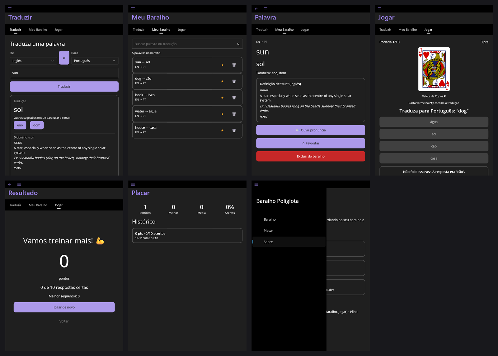

# 🃏 Baralho Poliglota

App **.NET MAUI** para aprender vocabulário: traduza palavras, guarde no seu baralho e jogue com
cartas de verdade. Projeto da atividade de APIs (mín. 2 APIs externas, 3 modos de navegação, POO).

Especificação completa: [SPEC.md](SPEC.md).



Telas individuais em [docs/screenshots](docs/screenshots).

## APIs

| API | Uso |
|---|---|
| [Deck of Cards API](https://deckofcardsapi.com) | Baralho e cartas do jogo |
| [MyMemory Translation](https://mymemory.translated.net/doc/spec.php) | Tradução de palavras |
| [Free Dictionary API](https://dictionaryapi.dev) | Definição, fonética e áudio (inglês) |

Nenhuma exige chave de API.

## Navegação

Flyout (menu lateral) · TabBar (Traduzir, Meu Baralho, Jogar) · Pilha (detalhe da palavra e resultado).

## Estrutura

```
src/BaralhoPoliglota.Core   Modelos, serviços de API, repositórios e regras do jogo (net10.0)
src/BaralhoPoliglota        App MAUI: Views (XAML), ViewModels (MVVM), Shell, DI
tests/BaralhoPoliglota.Tests  Testes xUnit do Core
```

## Como rodar

Requisitos: .NET 10 SDK com a workload MAUI (`dotnet workload install maui`).

```powershell
# testes
dotnet test tests/BaralhoPoliglota.Tests

# app no Windows
dotnet run --project src/BaralhoPoliglota -f net10.0-windows10.0.19041.0

# app no Android (emulador ou aparelho conectado)
dotnet build src/BaralhoPoliglota -f net10.0-android -t:Run
```

## Como jogar

1. Na aba **Traduzir**, traduza palavras e toque em **Guardar no baralho** (mínimo de 4).
2. Na aba **Jogar**, inicie uma partida de 10 rodadas.
3. Cartas vermelhas (♥ ♦) → múltipla escolha. Cartas pretas (♠ ♣) → digite a tradução.
4. O valor da carta dá os pontos (Ás = 11, figuras = 10) e acertos seguidos dão bônus de até +5.

## Observações

- O MyMemory é colaborativo: a primeira sugestão pode estar errada (ex.: `sun → eno`). Por isso o app
  mostra outras sugestões e deixa você tocar na certa antes de guardar.
- A cota gratuita do MyMemory é limitada por dia; quando acaba, o app avisa.
- O dicionário só tem palavras em inglês: as definições aparecem quando um dos idiomas é o inglês.
